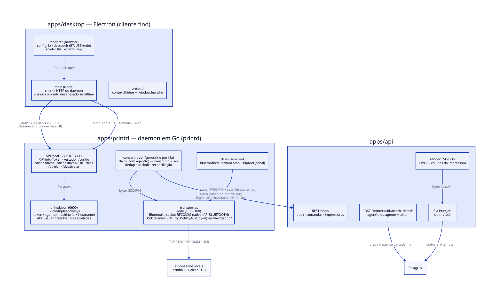

# leandroSys — printd (daemon de impressão em Go)

> **O que é:** o daemon que **é o dono da fila** no formato do "edge-printer" do
> tablemanager: drena o `claim` de todas as filas atreladas a esta máquina, transmite os
> bytes e manda o `ack` — um worker por fila, em paralelo. Ele expõe uma **API local em
> `127.0.0.1:7411`** e é o que o Electron (`apps/desktop`) conversa: o app de desktop é
> só um cliente de UI.
>
> Zero dependência externa em Go (só stdlib) e **sem módulo nativo**: no Linux o
> Bluetooth usa o socket RFCOMM do próprio kernel (`AF_BLUETOOTH` via `syscall`) e o USB
> usa `termios`; no Windows o mesmo código usa a API de porta serial (`kernel32.dll`) e o
> registro (`advapi32.dll`), carregados por `syscall.LoadDLL` — sem binding C, sem
> `golang.org/x/sys`, sem módulo nativo. Build tags (`//go:build linux` / `windows`)
> separam os arquivos de cada SO.

Um pedido de cozinha com rota para duas filas sai **nas duas vias** (fan-out), e o
printd drena as duas em paralelo — comprovado por `pnpm --filter @leandrosys/printd smoke`.

---

## 1. Arquitetura



| peça | arquivo | responsabilidade |
|---|---|---|
| entry | `cmd/printd/main.go` | flags, boot, banner `printd pronto addr=… token=…` |
| API local | `internal/server` | `/estado` `/config` `/dispositivos` `/dispositivos/usb` `/filas` `/atrelar` `/desatrelar` `/impressoras/:id/teste` |
| concentrador | `internal/agent` | goroutine por fila: claim → transmitir → ack (dedup, backoff) + reconciliação |
| cliente da API | `internal/api` | REST leandroSys: login sob demanda (401 → login → repete), attach/detach com `agentId` |
| transportes | `internal/transport` | rede (TCP), Bluetooth (RFCOMM do kernel no Linux; COM virtual no Windows) e USB (serial 8N1: `termios`/`/dev/usb/lp*` no Linux, porta `COMn` no Windows) |
| BlueZ / Bluetooth | `internal/bluez` | Linux: `bluetoothctl`, `hcitool scan`, `sdptool` — tudo **sem root**. Windows: registro (`Enum\Bluetooth`) para pareados + API SDP nativa |
| registro Win | `internal/winreg` | shim mínimo da `advapi32` (só Windows) — listar COM/USB/BT sem dependência externa |
| persistência | `internal/config` | `printd.json` (token, identidade do agente, API, credenciais, filas atreladas) |

O daemon é **independente do Electron**: roda sozinho (`pnpm --filter @leandrosys/printd
start`) e continua imprimindo mesmo com a UI fechada — o Electron só o sobe se não
estiver respondendo (spawn desanexado).

## 2. Atrelar uma fila existente a um dispositivo local

**Não existe criação de impressora por aqui.** A fila (nome, colunas, codepage, destino
da conta, rotas) é cadastrada no admin (`apps/web`, `POST /printers`). O daemon só
descobre o hardware e **atrela** a fila a um dispositivo desta máquina.

1. **Configuração, uma única vez:** `POST /config` com API + usuário/senha do agente
   (`impressora`). O daemon **testa as credenciais antes de gravar** (errada → `502` e
   nada é persistido). Não há código de pareamento.
2. **Descobrir dispositivos locais** (a UI lista os três):
   - Bluetooth: `GET /dispositivos` — Linux: conhecidos (`bluetoothctl devices`), com
     `?scan=1` junta uma varredura (`hcitool scan`, ~10s); Windows: pareados
     (`Enum\Bluetooth` do registro);
   - USB: `GET /dispositivos/usb` — Linux: portas seriais (`/dev/serial/by-id/*`,
     `/dev/ttyUSB*`, `/dev/ttyACM*`) e impressoras de classe printer (`/dev/usb/lp*`),
     com nome do produto (sysfs); Windows: portas COM (`COM Database` + `Enum\USB`);
   - Rede: formulário `host[:porta]` (padrão 9100) na UI.
3. **Atrelar:** `POST /atrelar {printerId, endereco, transporte?, baud?}` — o
   transporte é inferido (`/dev/…` ou `COMn` → USB, `AA:BB:CC:DD:EE:FF` → Bluetooth,
   IP → rede) e
   o daemon chama `POST /printers/:id/attach` na API com `agentId` + `agentName`
   (derivados de `/etc/machine-id` no Linux, ou de token persistido, + hostname) e grava
   o vínculo local.

| situação | resposta |
|---|---|
| fila/dispositivo ausentes ou endereço inválido | `400` |
| fila inexistente na API | `404` |
| fila já atrelada a **outro** agente | `409` (a API recusa o attach) |
| API indisponível | `502` com a mensagem da API |
| sem token do daemon | `401` |

4. **Desatrelar:** `POST /desatrelar {printerId}` — limpa o vínculo na API (`POST
   /printers/:id/detach`) e remove do `printd.json`. A fila, as rotas e o histórico
   permanecem no admin.

**Reconciliação com a API (fonte de verdade):** no boot, após trocar a configuração e
quando um `claim` responde `409`/`404`, o agente chama `GET /printers` e:
- espelha no `printd.json` apenas as filas com `agentId === agente local`;
- instalações antigas (fila no config sem vínculo na API) são **auto-atreladas** na
  primeira reconciliação (migração);
- filas atreladas a outro agente ou apagadas no admin desaparecem daqui.

## 3. Ciclo operacional (por fila)

```text
1 worker (goroutine) por fila atrelada:
  1. POST /print-jobs/claim {printerId, agentId, limit: 8}
     ├─ jobs[] → para cada job, na ordem:
     │     · já impresso nesta sessão? → só reenvia ack (dedup, não reimprime)
     │     · data (base64) → bytes ESC/POS crus
     │     · transmite (1 job por vez — nunca intercala cupons)
     │     · POST /print-jobs/:id/ack {success, error?}   ← obrigatório até no erro
     ├─ vazio → dorme ~2s (± jitter)
     ├─ 409/404 (inativa/removida/desatrelada) → dorme 15s e **reconcilia**
     ├─ dispositivo USB ausente → dorme 15s **sem claim**
     └─ erro de rede/API → backoff exponencial ± jitter (teto 60s)
```

Garantias derivadas do fluxo (`docs/fluxo.md` §6–§7): **todo job recebido gera `ack`**;
o servidor é at-least-once, então o dedup por `job_id` evita reimpressão; e nunca há
`claim` sem transporte disponível (senão uma impressora sem hardware queimaria as 3
tentativas dos jobs. O `agentId` no claim é conferido contra o vínculo salvo na API —
outra máquina não consegue drenar a fila atrelada a esta.

## 4. Transportes

| transporte | Linux | Windows | estado |
|---|---|---|---|
| `NETWORK` | TCP `host[:porta]` (padrão 9100) | idem | **funcionando** |
| `BLUETOOTH` | SDP (`sdptool browse`) → socket `AF_BLUETOOTH`/`BTPROTO_RFCOMM` → connect → write | MAC → **COM virtual** do emparelhamento (perfil *Serial Port*) → `WriteFile` | **funcionando** |
| `USB` | serial 8N1 via `termios` (baud configurável, `tcdrain` antes de fechar) ou `write` em `/dev/usb/lp*` | porta COM (`\\.\COMn`, DCB 8N1 via `Get/SetCommState`, baud do config) | **funcionando** |

No USB o worker **não faz claim se o dispositivo não existe agora** (`os.Stat` no char
device; no Windows, tentativa de `CreateFileW` na COM) — desplugou, ele espera sem
queimar tentativas. O caminho preferido no Linux é `/dev/serial/by-id/*` (estável entre
replugadas) e o usuário do daemon precisa estar no grupo `dialout`. No Windows as portas
vêm do registro (`COM Database` + `Enum\USB`), sem driver extra.

**Bluetooth no Linux, sem segredo:** `syscall.Socket(31, SOCK_STREAM, 3)` + a `sockaddr_rc`
montada à mão ({u16 family; u8[6] bdaddr little-endian; u8 channel}). O kernel devolve
`EINPROGRESS` mesmo em socket bloqueante (o link ACL é enfileirado), então a conexão é
completada com `select` + `SO_ERROR` sob prazo próprio — depois disso as escritas voltam
a ser bloqueantes. O smoke faz um **pré-voo** contra o kernel real: conectar num MAC
morto tem que dar erro de rede, nunca `invalid argument` (prova que a struct está
correta). Canal RFCOMM vem do SDP (`sdptool browse`, preferindo o perfil *Serial Port*).

**Bluetooth no Windows:** a plataforma não expõe SDP usável sem a API bruta de Bluetooth
— o caminho suportado é parear a impressora com o perfil **Serial Port**, que faz o
Windows criar uma **COM virtual** (`Enum\BTHPORT\Device\<mac>` → `PortName`). O daemon
resolve `MAC → COMx` pelo registro e transmite pelo mesmo `WriteFile` do USB; se o MAC
não tiver COM virtual, `Disponivel` responde `false` e o worker dorme 15s **sem claim**
(mesma garantia do USB desplugado). Descoberta de pareados: `Enum\Bluetooth` (o `?scan=1`
devolve só os já pareados — varredura ativa requeriria a API de discovery, fora do escopo).

**Build por SO (tags `//go:build linux|windows`):**

```bash
go build -o bin/printd ./cmd/printd          # SO atual
GOOS=windows GOARCH=amd64 go build -o bin/printd.exe ./cmd/printd   # cross-build
```

Zero dependência externa nos dois alvos: o Windows usa só stdlib + `syscall.LoadDLL`
(`kernel32` para a COM, `advapi32` para o registro) — shim do registro em
`internal/winreg`, sem `x/sys` nem outra dependência nova no `go.mod`.

## 5. Configuração e token

`printd.json` no diretório de config do usuário — `os.UserConfigDir()` do Go: Linux
`~/.config/leandrosys/printd.json` (respeita `XDG_CONFIG_HOME`), Windows
`%APPDATA%\leandrosys\printd.json`, macOS `~/Library/Application Support/leandrosys/printd.json`
(criado no 1º start com token de 16 bytes e modo `0600`):

```json
{
  "porta": 7411,
  "token": "…",
  "agenteId": "b3f1c2…",
  "agenteNome": "cozinha-pc",
  "apiUrl": "http://localhost:3000/api",
  "usuario": "impressora",
  "senha": "impressora123",
  "impressoras": [ { "id": "…", "nome": "Cozinha 1", "endereco": "192.168.0.10:9100", "transporte": "NETWORK", "colunas": 32, "codepage": 19 } ]
}
```

`agenteId` é o primeiro par de hex de `sha256(machine-id + hostname)`; sem
`/etc/machine-id` (Windows/macOS) o fallback é um token aleatório persistido no próprio
`printd.json` — estável entre restarts. É ele que a API usa para saber **quem** atrelou cada fila e para
recusar o claim de outra máquina.

Toda rota local exige o header `X-Printd-Token` (mesmo valor). Como o daemon escuta só
em `127.0.0.1` e não responde CORS, um site malicioso no navegador não consegue nem ler
resposta nem agir — e o Electron lê o token do arquivo (mesmo usuário do disco).

| flag | papel | padrão |
|---|---|---|
| `--config` | caminho do `printd.json` | dir de config do usuário + `leandrosys/printd.json` |
| `--porta` | porta do servidor local (persiste no config) | `7411` |
| `--api` | sobrescreve a API configurada | — |

## 6. Smoke E2E (sem interface)

```bash
# API em http://localhost:3000/api com seed aplicado
pnpm --filter @leandrosys/printd smoke
```

`cmd/smoke` sobe o daemon num config temporário e valida de ponta a ponta: pré-voo do
Bluetooth no kernel real → configuração (credenciais testadas) → **cria 2 filas no
admin e as atrela pelo daemon** (`POST /atrelar`) em 2 sinks TCP → rotas do mesmo
produto nas duas → comanda enviada (2 jobs) → drenagem paralela (as duas vias saem com
o mesmo pedido) → jobs `DONE` → desatrela e apaga as filas.

## 7. Estados expostos na UI

| estado | significado |
|---|---|
| `ociosa` | sem jobs, esperando o próximo poll |
| `imprimindo` | transmitindo um job |
| `backoff` | API indisponível; mostra quando tenta de novo |
| `sem-transporte` | dispositivo USB não encontrado agora (ou transporte sem suporte) |
| `parada` | fila inativa/removida/desatrelada no sistema (dispara reconciliação) |

Mais: contadores de impressos/falhas, último job + horário, `lastError`, e o log do
daemon (`/estado` devolve as 60 últimas linhas).

## 8. Desenvolvimento

```bash
pnpm --filter @leandrosys/printd build      # go build -o bin/printd ./cmd/printd
pnpm --filter @leandrosys/printd start      # roda o daemon (API no ar para drenar)
pnpm --filter @leandrosys/printd smoke      # E2E headless (§6)
pnpm --filter @leandrosys/printd typecheck  # go vet ./...
```

Cross-build para Windows (mesmo código, build tags):

```bash
cd apps/printd
GOOS=windows GOARCH=amd64 go build -o bin/printd.exe ./cmd/printd
```

Testes por SO: `go test ./...` roda os testes do SO atual; `GOOS=windows go test -c`
compila os testes do alvo Windows (os puros — COM/registro/BAUD — também rodam em CI
via Wine quando disponível).

## 9. Referências

- Fluxo completo e garantias: [`docs/fluxo.md`](../../docs/fluxo.md)
- Cliente de UI: [`apps/desktop/README.md`](../desktop/README.md)
- Contrato da API (attach/detach/claim com `agentId`): [`apps/api/README.md`](../api/README.md)
- Base conceitual (at-least-once, dedup, backoff): `tablemanager/print-protocol.md` §6–§7
