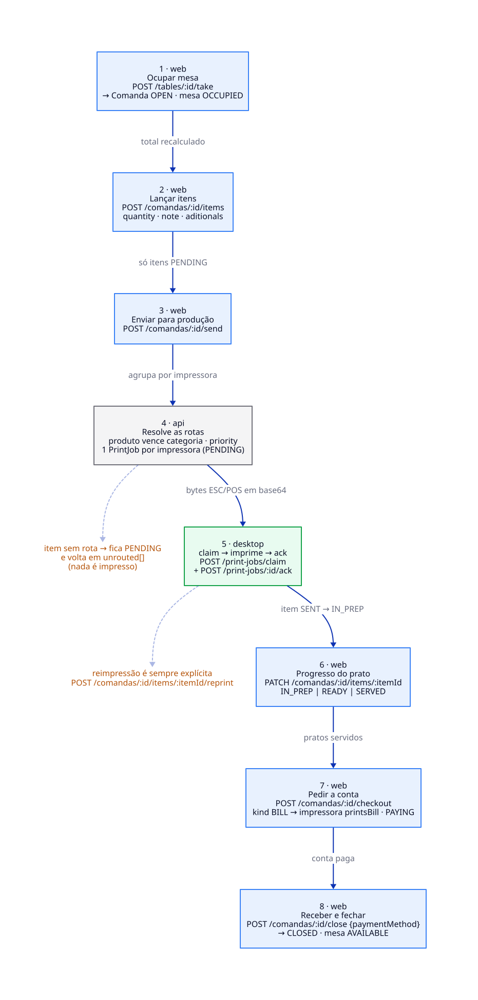
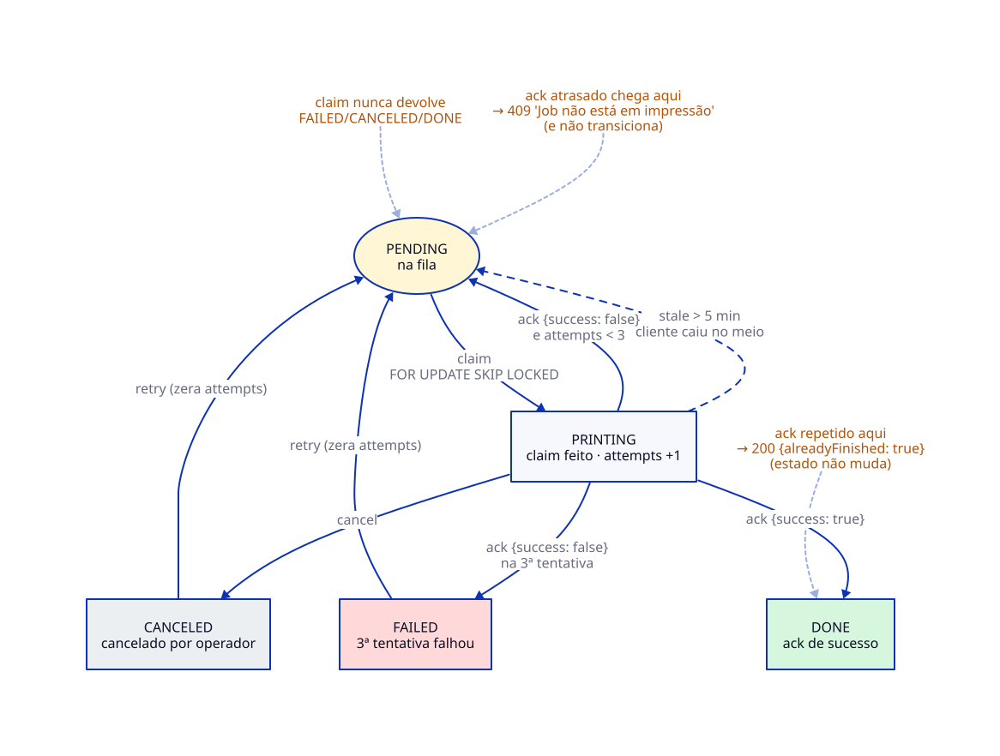
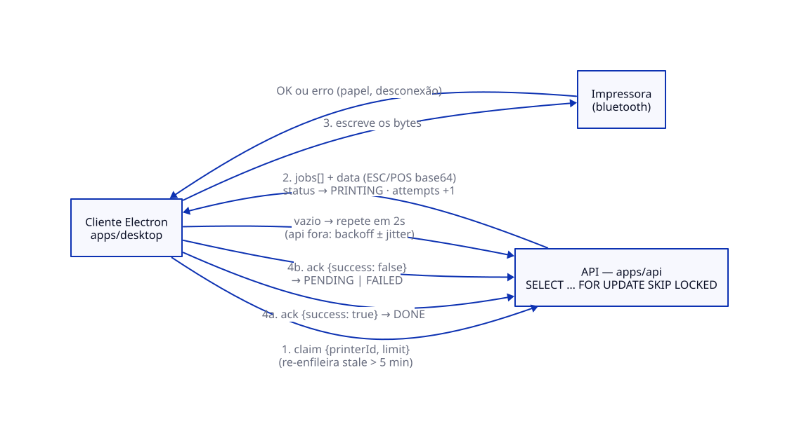

# leandroSys — fluxo de ponta a ponta

> **Escopo:** mesa → comanda → itens → envio → rotas → fila → claim → impressão → ack →
> conta → fechamento — com garantias, limitações e casos-limite.
>
> Documento vivo: quando o código mudar, mude este doc. Os caminhos de código citados estão
> em [§9 Mapa para o código](#9-mapa-para-o-código).
> Os diagramas são fontes D2 em [`docs/diagrams/`](./diagrams) — regenere os SVG com
> `pnpm docs:build`.

---

## 1. Objetivo e atores

Descrever uma única vez o caminho correto de um pedido, do lançamento na mesa até o cupom
sair na impressora e a conta ser fechada — incluindo o que a API **garante**, o que **não
garante** e o que acontece quando algo dá errado no meio.

| ator | papel | onde vive |
|---|---|---|
| Salão / caixa | ocupa mesa, lança itens, envia para produção, pede conta, recebe e fecha | `apps/web` |
| API | valida, resolve as rotas, enfileira, serve `claim`/`ack` | `apps/api` |
| Fila (`PrintJob`) | banco de espera durável, **um por impressora** | Postgres |
| Daemon de impressão (`printd`) | drena a fila da impressora, transmite os bytes ESC/POS, reporta o resultado | `apps/printd` (UI em `apps/desktop`) |
| Impressora ESC/POS | executa o trabalho físico (Bluetooth · USB · rede) | fora do repo |

**Regra de ouro:** estado de negócio e estado de impressão são mundos diferentes. Conversam
por exatamente dois pontos:

1. **`send`** — a intenção de imprimir vira `PrintJob` durável (`PENDING`);
2. **`ack`** — o cliente relata o resultado físico (`DONE` ou volta à fila).

Nada entre esses pontos prova que papel saiu. Ver [§7 Limitações](#7-limitações-o-que-não-é-garantido).

---

## 2. Fluxo de negócio

### Passos e efeitos

| # | Quem | Chamada | Efeito |
|---|---|---|---|
| 1 | operador | `POST /tables/:id/take` | cria comanda `OPEN`, mesa → `OCCUPIED` |
| 2 | operador | `POST /comandas/:id/items` | item `PENDING`, total recalculado em transação |
| 3 | operador | `POST /comandas/:id/send` | itens `PENDING` → `SENT` + jobs enfileirados (§3) |
| 4 | API | — | resolve rotas, agrupa **1 cupom por impressora** |
| 5 | `printd` | `claim` → imprime → `ack` | ver [§5](#5-sequência-claim--transmissão--ack) |
| 6 | operador | `PATCH /comandas/:id/items/:itemId` | `IN_PREP` \| `READY` \| `SERVED` |
| 7 | operador | `POST /comandas/:id/checkout` | comanda → `PAYING` + job `BILL` (idempotente) |
| 8 | operador | `POST /comandas/:id/close` | comanda → `CLOSED`, mesa → `AVAILABLE` |

### Estados

| entidade | estados | transições |
|---|---|---|
| **Mesa** | `AVAILABLE` · `OCCUPIED` · `RESERVED` | `take` → `OCCUPIED` · `reserve` → `RESERVED` · `close`/`release`/`delete` → `AVAILABLE` |
| **Comanda** | `OPEN` · `PAYING` · `CLOSED` | `checkout`: `OPEN`→`PAYING` · `close`: `OPEN`\|`PAYING`→`CLOSED` |
| **Item** | `PENDING` · `SENT` · `IN_PREP` · `READY` · `SERVED` · `CANCELED` | `send`: `PENDING`→`SENT` · `PATCH`: → `IN_PREP`/`READY`/`SERVED` · `DELETE`: → `CANCELED` |

Observações que quase sempre viram bug:

- Só se lança item em comanda `OPEN` (em `PAYING`/`CLOSED` → `409`).
- `checkout` duas vezes: a segunda responde `200` com `billJobId: null` e aviso — **não**
  imprime a conta de novo.
- `close` sem ter passado por `checkout` imprime a conta na sequência (comanda ainda `OPEN`).
- Fechar com itens nunca enviados devolve `warnings` com a contagem — a comanda fecha mesmo
  assim.
- `DELETE /comandas` só apaga comanda sem itens; caso contrário `409`.

### Papéis

Leitura exige token. Escrita de operação (`take`, `items`, `send`, `checkout`, `close`,
`reprint`) exige papel **operador**: `ADMIN`, `WAITER` ou `CASHIER`. Configuração (mesas,
impressoras, rotas, catálogo, usuários) exige `ADMIN`. `CHEF` só lê — e é o papel do usuário
`impressora` do seed, que usa `claim`/`ack` (essas rotas exigem apenas token autenticado).

---

## 3. Roteamento: como um item vira job

Resolvido em `sendComanda` + `loadRouteMaps`/`pickPrinters`.

1. **Rota por produto vence rota por categoria** (`pickPrinters`: `byProduct ?? byCategory`).
2. **`priority` desempata** dentro de cada grupo (impressoras ordenadas por `priority DESC`).
3. Um item pode ir para **N impressoras** (uma rota por produto/categoria para cada).
4. **Sem rota → nada é impresso**: o item sai do lote, entra em `unrouted[]` e **continua
   `PENDING`**. Se *nenhum* item do lote tiver rota, a chamada inteira falha com `409`
   `"Nenhuma rota de impressão para os itens pendentes"` (o `unrouted[]` vem no corpo).
5. **Agrupamento: um cupom por impressora por envio.** Todos os itens `PENDING` que caem na
   mesma impressora viram **um** job `ITEM` (cozinha, por exemplo, recebe tudo junto).
6. **A conta é separada:** job `BILL` vai só para a impressora com `printsBill: true` (única
   por vez; sem nenhuma ativa → `warnings`). Existe também `COMANDA` e `TEST` (`kind` do job).
7. Reimpressão (`/reprint`) usa a **mesma rota** do envio normal e gera um job novo.

Itens já `SENT` **não** são reenviados num novo `send` — por isso é possível enviar de novo
com itens novos sem duplicar os antigos.

**Fan-out (um pedido em duas cozinhas):** é o caso "item vai para N impressoras". Criando
uma rota do mesmo produto para `Cozinha 1` e `Cozinha 2`, o `send` gera **um job por
impressora com os mesmos itens** — as duas filas recebem o mesmo pedido e o daemon
`printd` drena as duas ao mesmo tempo. Validado de ponta a ponta por `pnpm --filter
@leandrosys/printd smoke` (§10).

---

## 4. Ciclo de vida de um `PrintJob`

| Transição | Gatilho | Onde |
|---|---|---|
| `PENDING` → `PRINTING` | `claim` (e re-enfileira `stale` antes) | `printers/routes.ts` |
| `PRINTING` → `DONE` | `ack {success: true}` | idem |
| `PRINTING` → `PENDING` | `ack {success: false}` com `attempts < 3` | idem |
| `PRINTING` → `FAILED` | `ack {success: false}` na 3ª tentativa | idem |
| `PRINTING` → `PENDING` | job parado > 5 min (cliente caiu) | `claim` |
| `FAILED`/`CANCELED` → `PENDING` | `retry` (zera `attempts`) | idem |
| qualquer → `CANCELED` | `cancel` (exceto `DONE`) | idem |

### Constantes

| constante | valor | significa |
|---|---|---|
| `MAX_ATTEMPTS` | **3** | 3 falhas → `FAILED` (fica lá até um `retry` manual) |
| `STALE_MS` | **5 min** | `PRINTING` mais antigo que isso volta para `PENDING` |
| `CLAIM_DEFAULT` | **8** | jobs por `claim` (limite aceito: 1–32) |
| `QUEUE_DEFAULT` | **50** | `limit` padrão das listagens (máx. 200) |

---

## 5. Sequência `claim` → transmissão → `ack`

1. **`POST /print-jobs/claim` `{printerId, limit?}`** — numa única transação:
   - devolve para `PENDING` os jobs daquela impressora em `PRINTING` há > 5 min;
   - busca `PENDING` com **`FOR UPDATE SKIP LOCKED`**, ordenado por `createdAt ASC`;
   - marca como `PRINTING` e incrementa `attempts`.
   - Responde os jobs com **`columns`/`codepage` da impressora** e **`data` = bytes ESC/POS
     em base64** — o cliente não renderiza nada, só transmite.
2. **Transmite** um job por vez, na ordem recebida, para a impressora.
3. **`POST /print-jobs/:id/ack` `{success, error?}`**:
   - `success: true` → `DONE`;
   - `success: false` → volta para `PENDING` (`lastError` gravado) ou `FAILED` na 3ª;
   - job já `DONE`/`CANCELED` → `200 {alreadyFinished: true}` (**sem transição**);
   - job já `PENDING` → **`409`** "Job não está em impressão" (ack atrasado; não transiciona).
4. **Sem trabalho** → repete em ~2 s. API fora do ar → backoff exponencial ± jitter.

O loop inteiro está no [`apps/desktop/README.md`](../apps/desktop/README.md).

---

## 6. Garantias (o que a API de fato garante)

1. **Dois clientes nunca recebem o mesmo job na mesma rodada.** O `claim` inteiro roda numa
   transação com `FOR UPDATE SKIP LOCKED`.
2. **Ordem por impressora é FIFO.** `ORDER BY createdAt ASC` — um job que voltou por `stale`
   mantém o `createdAt` original e volta a disputar na posição dele.
3. **Entrega é at-least-once.** `stale` (5 min) e `retry` podem re-entregar um job que já foi
   impresso. **Quem recebe deduplica.**
4. **`ack` é idempotente.** Repetir um `ack` de job finalizado não muda estado (`200`
   `alreadyFinished`); `ack` chegado fora de `PRINTING` não contamina (`409`).
5. **Tentativas são contadas no claim.** `attempts` sobe no `claim`, não no `ack` — dois
   clientes disputando não diluem o limite de 3.
6. **Operações de comanda são seriais.** `send`/`checkout`/`close`/`take` trançam a comanda
   (`FOR UPDATE`) e rodam em transação: dois envios simultâneos não duplicam jobs, dois
   checkouts não imprimem duas contas.
7. **A conta é idempotente por design** (`checkout` em `PAYING` não reenfileira).
8. **Ordem serial de escrita é responsabilidade do cliente** — 1 job por vez por impressora,
   senão os bytes se intercalam. A API não pode garantir isso sozinha.

---

## 7. Limitações (o que **não** é garantido)

Herdado da lição do `tablemanager` (`print-protocol.md` §6–7): **exatamente-uma-vez não
existe.**

1. **Cupom duplicado é possível.** O cliente imprime e cai antes do `ack`: em 5 min o job
   volta para `PENDING` e é re-entregue. Sem deduplicação no cliente, sai papel duas vezes.
2. **`ack` ≠ papel saiu.** `success: true` prova que o cliente *disse* que enviou. Papel
   acabou, buffer cheio, impressora desconectada depois do write: a API não sabe.
3. **Estado de negócio ≠ estado de impressão.** Item `SERVED` não implica job `DONE`; job
   `FAILED` não implica item voltar a `PENDING` (o item segue no fluxo do salão).
4. **Um cliente por impressora não é proibido.** Dois processos com o mesmo `printerId`
   competem — `SKIP LOCKED` evita entrega simultânea, mas os dois imprimem alternadamente.
5. **`unrouted` só aparece se ao menos um item do lote tem rota**; sem nenhuma rota é `409`
   no lugar da lista (o corpo ainda traz `unrouted[]`).
6. **Sem fila local offline.** API fora → nada é impresso até voltar (os jobs ficam
   `PENDING`; no MVP o cliente não guarda bytes pendentes em disco).
7. **`FAILED` exige ação humana** — não há retry automático depois da 3ª falha.
8. **Auditoria de reimpressão é fraca:** dá para reconstruir por `attempts`, `claimedAt`,
   `finishedAt` e `lastError`, mas não há quem-imprimiu-quando além disso.

---

## 8. Casos-limite e erros esperados

| Situação | HTTP | Efeito / o que fazer |
|---|---|---|
| `take` em mesa `OCCUPIED` | 409 | "Mesa já está ocupada" — não cria comanda |
| `take` em mesa `RESERVED` | 409 | cancele a reserva antes |
| item em comanda `PAYING`/`CLOSED` | 409 | "Só é possível lançar itens em comanda aberta" |
| `send` sem item `PENDING` | 400 | "Nenhum item pendente de envio" |
| `send` sem **nenhuma** rota | 409 | corpo com `unrouted[]`; nada mudou |
| `send` com rota parcial | 200 | `sent` + `jobIds` + `unrouted[]`; sem rota fica `PENDING` |
| `checkout` em comanda `PAYING` | 200 | `billJobId: null` + aviso — não imprime de novo |
| `close` sem impressora `printsBill` | 200 | `warnings: ["Nenhuma impressora ativa configurada para contas"]` |
| `close` com itens nunca enviados | 200 | `warnings` com a contagem; comanda fecha mesmo assim |
| `close`/`reprint` de comanda `CLOSED` | 409 | "Comanda já foi fechada" |
| `claim` de impressora inexistente / inativa | 404 / 409 | cliente deve parar de pollar essa impressora |
| `ack` de job `PENDING` | 409 | ack atrasado — **não** transiciona |
| `ack` de job `DONE`/`CANCELED` | 200 | `{alreadyFinished: true}` — idempotente |
| `ack {success:false}` na 3ª tentativa | 200 | `status: "FAILED"` — exige `retry` manual |
| `retry` de job `DONE` | 409 | "Job já foi impresso" |
| `retry` de `PENDING`/`PRINTING` | 400 | "Job já está na fila" |
| `cancel` de job `DONE` | 409 | "Job já foi impresso" |
| id inválido na URL/corpo | 400 | validação Zod (`z.uuid()`) |
| violação de unicidade (número de mesa/usuário) | 409 | mapeada de `23505` |

---

## 9. Mapa para o código

| Etapa | Arquivo |
|---|---|
| `take`, `transfer`, `reserve`, `release` | `apps/api/src/modules/tables/routes.ts` |
| abrir comanda, itens, `send`, `checkout`, `close`, `reprint` | `apps/api/src/modules/comandas/service.ts` |
| endpoints HTTP das comandas | `apps/api/src/modules/comandas/routes.ts` |
| rotas (produto/categoria → impressora) e agrupamento | `apps/api/src/modules/printing/queue.ts` |
| render ESC/POS (bytes prontos) | `apps/api/src/modules/printing/escpos.ts` |
| formatos de cupom (`ITEM`, `BILL`, `TEST`) | `apps/api/src/modules/printing/tickets.ts` |
| `claim`, `ack`, `retry`, `cancel`, fila, CRUD de impressoras | `apps/api/src/modules/printers/routes.ts` |
| constantes (`MAX_ATTEMPTS`, `STALE_MS`, `CLAIM_DEFAULT`) | idem, linhas 11–16 |
| papéis (`requireAuth`/`requireOperator`/`requireAdmin`) | `apps/api/src/lib/auth.ts` |
| modelo de dados e enums | `apps/api/src/prisma/contract.prisma` |
| agente de impressão (claim/ack, dedup, backoff, reconciliação) | [`apps/printd/README.md`](../apps/printd/README.md) — `apps/printd/internal/agent` |
| transportes (rede, Bluetooth RFCOMM nativo e USB termios) | `apps/printd/internal/transport` |
| API local do daemon (config/descoberta/atrelar/estado) | `apps/printd/internal/server` |
| UI (cliente fino do daemon) | [`apps/desktop/README.md`](../apps/desktop/README.md) |

---

## 10. Checklist do agente de impressão (`apps/printd`)

O que o agente precisa cumprir para o fluxo ficar "certinho" (spec completa em
[`apps/printd/README.md`](../apps/printd/README.md)) — hoje o agente é o **daemon em Go
`printd`**: descobre os dispositivos locais (Bluetooth/USB/rede), atrela filas já
cadastradas no admin com a identidade dele (`agentId`) e drena todas as filas atreladas
a esta máquina (uma goroutine por fila); o `apps/desktop` é só a UI que conversa com ele
em `127.0.0.1`:

- [x] autenticar com a credencial `impressora` (guardada no `printd.json`) e manter o
  token vivo (login sob demanda: 401 → login → repete);
- [x] atrelar fila existente (`POST /printers/:id/attach` com `agentId`) a um
  dispositivo descoberto — sem criar impressora pelo agente e sem código de pareamento
  (verificado no smoke);
- [x] reconciliar os vínculos com `GET /printers` (boot, troca de config e claim
  409/404): só filas com `agentId === agente local` ficam no `printd.json`;
- [x] pollar `claim` da **sua** fila (`agentId` no corpo), 1 job por vez, na ordem recebida;
- [x] decodificar `data` (base64) e transmitir os bytes crus — nada de renderizar;
- [x] mandar `ack {success}` para **todo** job recebido, inclusive nos caminhos de erro;
- [x] em `409` de `ack`, não reenviar (o job já saiu de `PRINTING`);
- [x] deduplicar `job_id` já finalizados nesta sessão (o servidor re-entrega at-least-once);
- [x] backoff exponencial ± jitter quando a API estiver fora;
- [x] expor na tela: API ok/abaixo, estado por impressora, último job e o `lastError`;
- [ ] deixar `retry`/`cancel` acessíveis para o operador resolver `FAILED` à mão;
- [x] transporte USB: serial 8N1 via `termios` (baud configurável, padrão 9600) ou
  `/dev/usb/lp*`; sem dispositivo o worker dorme sem consumir tentativas.

---

## Mudanças neste documento

| quando | o que mudou |
|---|---|
| — | primeira versão |
| agora | agente de impressão virou o daemon em Go `apps/printd` (API local em `127.0.0.1`); `apps/desktop` passou a ser só a UI — §9 e §10 atualizados |
